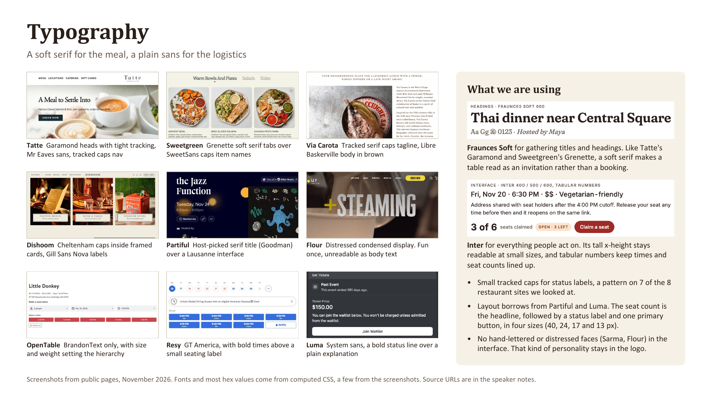
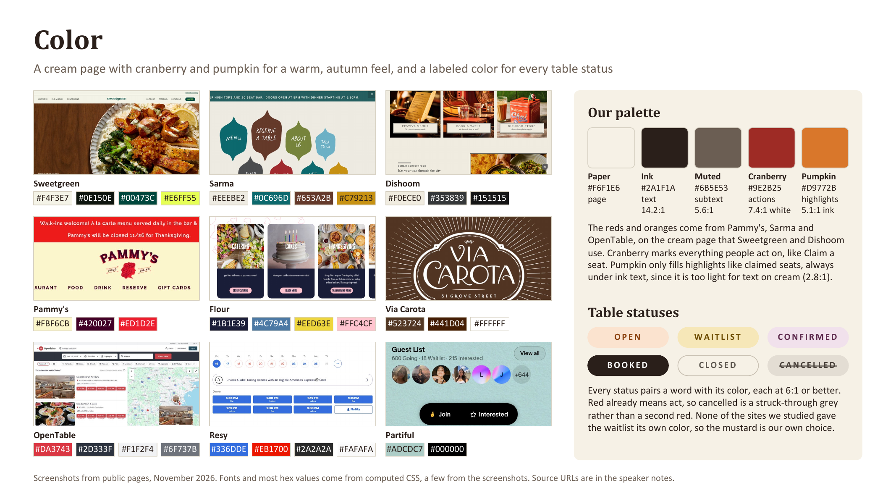

# Visual Design Study

These two slides collect screenshots from OpenTable, other reservation and invite tools (Resy, Partiful, Luma), and restaurant websites (Tatte, Sweetgreen, Sarma, Dishoom, Pammy's, Flour, Via Carota), and annotate the typography and color choices we are adopting for our interface. The editable deck is [visual-design-study.pptx](visual-design-study/visual-design-study.pptx), with a [PDF copy](visual-design-study/visual-design-study.pdf), and the source URLs are in its speaker notes.

## Typography

## Color

